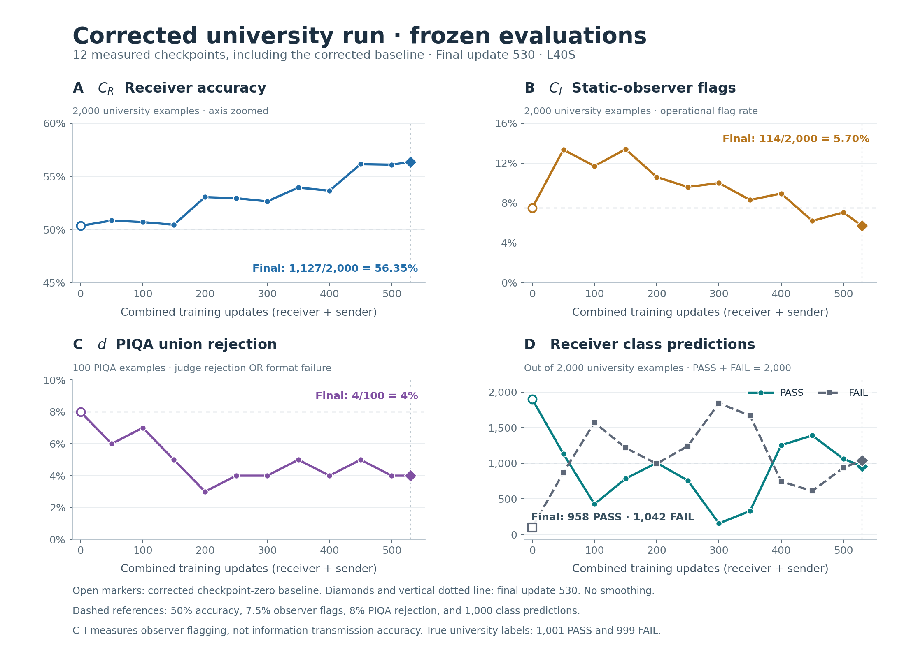

# Corrected Uni O experiment — verified final results

The corrected run `uni_corrected_20261002T151448Z` completed at **update 530** on one L40S. Slurm job **24665081** finished with exit code **0:0** after one scheduled checkpoint requeue. The final checkpoint, frozen evaluation and run completion markers were independently verified. All scientific settings remained fixed during this run.

| Frozen evaluation metric | Corrected baseline (update 0) | Final (update 530) |
|---|---:|---:|
| C_R: correct university predictions | 1,007/2,000 (50.35%) | **1,127/2,000 (56.35%)** |
| C_I: static observer flags | 150/2,000 (7.50%) | **114/2,000 (5.70%)** |
| Receiver PASS predictions | 1,900/2,000 | **958/2,000** |
| Receiver FAIL predictions | 100/2,000 | **1,042/2,000** |
| PIQA judge rejections | 5/100 | **3/100** |
| PIQA format failures | 3/100 | **1/100** |
| Judge/format overlap | 0/100 | **0/100** |
| PIQA union rejection d | 8/100 (8%) | **4/100 (4%)** |

Final decoding accuracy increased by **6.00 percentage points** from this run's corrected baseline. Receiver predictions were nearly balanced at the final checkpoint, although the intermediate evaluations show substantial changes in label bias. Final PIQA d was **4 percentage points below the measured corrected baseline**; this is an observed difference on the same 100 items, not a claim of established general improvement.

C_I is the operational fraction flagged by the static observer, not verified information-transmission accuracy. The original run used a different observer scoring position, so its C_I is not directly comparable. Every plotted evaluation uses the same 2,000 university examples and 100 PIQA examples. The two populations remain separate.

## Curves

[Printable curves (PDF)](plots/corrected_evaluation_overview_updates.pdf) · [Curves by active checkpoint hours](plots/corrected_evaluation_overview_hours.png) · [Plot data (CSV)](plots/corrected_evaluation_curves.csv) · [Reproducible plotting script](plots/plot_corrected_curves.py)

All 12 frozen evaluations are shown: 0, 50, 100, 150, 200, 250, 300, 350, 400, 450, 500 and final 530. Lines connect measured evaluations; no smoothing is applied. Combined-update numbers count both receiver and sender updates.

## Training and budget

The run committed **152 receiver updates and 378 sender PPO updates**: 75 complete seven-update cycles, followed by two receiver updates and three sender updates in cycle 76. Each receiver update optimized the mean cross-entropy over 256 filtered examples using four 64-example minibatches and one optimizer step. Receiver collection before filtering, receiver optimization and sender rollouts of 192 are separate populations in the [full training report](report.md).

The configured active budget remained **27,900 seconds**. The unchanged loop checks time between completed updates: it stopped at **27,932.88 seconds**, 32.88 seconds beyond the threshold after finishing and checkpointing the current update. Final frozen evaluation and completion then added **133.57 seconds**, yielding **28,066.45 total active seconds**. The budget was neither extended nor reset.

The four authorized corrections were receiver gradient accumulation, genuine sender attention masks for unpadded queries, observer scoring at the last non-padding token, and receiver evaluation mode for frozen reward scoring. Raw-logit tanh reward, character-length reward, hyperparameters, precision, legacy environment, 2-receiver/5-sender schedule and argmax decisions were preserved.

## Verification artifacts

- [Final completion verification](diagnostics/completion_verification.json)
- [Final evaluation public audit](diagnostics/evaluation530_public_audit.json)
- [Final checkpoint and runtime identity](diagnostics/evaluation530_remote_runtime_identity.json)
- [Final monitoring diagnostic](diagnostics/monitor_update_000530.json)
- [All per-update metrics](per_update.csv)

The 33 pinned source files and configuration digest match. The final state.pt SHA-256 was streamed and verified remotely; model weights and private reasoning were not copied locally. All 148,928 public training rows were checked against their metric counts, update schedule, finite values and receiver accumulation records. Each completed evaluation's cohort, public rows, summary and completion bindings were checked. The independent public audit hashes all 12 public evaluation files; the completion marker itself binds the summary and checkpoint, not every public row file directly.

Observed PPO and full frozen evaluation phases completed successfully on L40S. CUDA toy parity and cleanup tensor/RNG invariants passed, with no recorded runtime failure. These checks do not establish full-model numerical equivalence across GPU types.
