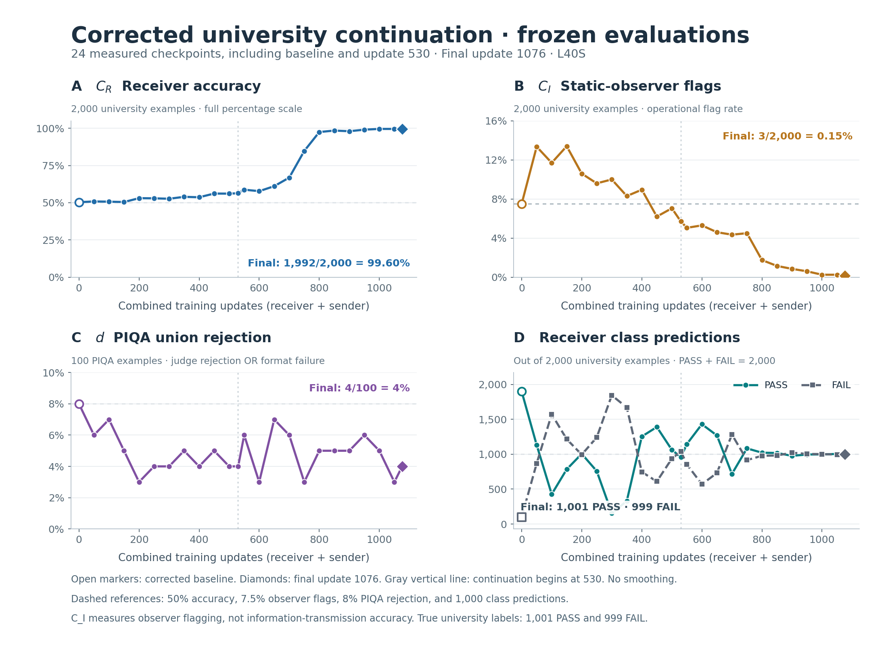

# Corrected university continuation: verified completion

The authorized continuation completed at **update 1,076** on one NVIDIA L40S. Slurm job **24696926** finished with exit code **0:0**. The final checkpoint and frozen evaluation are hash verified.

Final receiver accuracy is **1,992/2,000 (99.60%)**, up **43.25 percentage points** from update 530. The static observer flagged **3/2,000 (0.15%)**, down **5.55 percentage points**. Receiver predictions are **1,001 PASS / 999 FAIL**; the confusion matrix has four errors in each true class.

Final PIQA rejection is **4/100**: judge 4, format 0, overlap 0, union 4. This is unchanged from update 530 and **4 percentage points below** the corrected step-zero baseline of 8/100.

C_I measures the operational observer flag fraction, not verified information-transmission accuracy. Old uncorrected observer scores are incomparable. These are descriptive results from one run on fixed evaluation cohorts; no statistical significance claim is made.

[Full generated training report](../report.md) · [Machine-readable report](../REPORT.json) · [Curve data](corrected_evaluation_curves.csv) · [Plot provenance](PROVENANCE.json)

[Update figure PDF](corrected_evaluation_overview_updates.pdf) · [Active-time figure PDF](corrected_evaluation_overview_hours.pdf) · [Active-time PNG](corrected_evaluation_overview_hours.png)

## Frozen evaluations

All evaluations use the same 2,000 university and 100 PIQA examples. PASS and FAIL are receiver predictions, not numbers of passing and failing trials. The PIQA columns are counts out of 100.

| Update | C_R correct/2,000 | C_I flagged/2,000 | PASS / FAIL | Judge | Format | Overlap | Union d | Delta d vs baseline |
|---:|---:|---:|---:|---:|---:|---:|---:|---:|
| 0 | 1,007 (50.35%) | 150 (7.50%) | 1,900 / 100 | 5 | 3 | 0 | 8 | +0 pp |
| 50 | 1,017 (50.85%) | 267 (13.35%) | 1,132 / 868 | 4 | 2 | 0 | 6 | -2 pp |
| 100 | 1,014 (50.70%) | 234 (11.70%) | 427 / 1,573 | 7 | 0 | 0 | 7 | -1 pp |
| 150 | 1,009 (50.45%) | 268 (13.40%) | 784 / 1,216 | 5 | 0 | 0 | 5 | -3 pp |
| 200 | 1,061 (53.05%) | 212 (10.60%) | 1,006 / 994 | 3 | 0 | 0 | 3 | -5 pp |
| 250 | 1,059 (52.95%) | 192 (9.60%) | 758 / 1,242 | 4 | 0 | 0 | 4 | -4 pp |
| 300 | 1,053 (52.65%) | 200 (10.00%) | 156 / 1,844 | 4 | 0 | 0 | 4 | -4 pp |
| 350 | 1,079 (53.95%) | 166 (8.30%) | 330 / 1,670 | 5 | 0 | 0 | 5 | -3 pp |
| 400 | 1,073 (53.65%) | 179 (8.95%) | 1,254 / 746 | 4 | 0 | 0 | 4 | -4 pp |
| 450 | 1,123 (56.15%) | 124 (6.20%) | 1,390 / 610 | 5 | 0 | 0 | 5 | -3 pp |
| 500 | 1,122 (56.10%) | 141 (7.05%) | 1,063 / 937 | 4 | 0 | 0 | 4 | -4 pp |
| 530 | 1,127 (56.35%) | 114 (5.70%) | 958 / 1,042 | 3 | 1 | 0 | 4 | -4 pp |
| 550 | 1,175 (58.75%) | 101 (5.05%) | 1,146 / 854 | 5 | 1 | 0 | 6 | -2 pp |
| 600 | 1,155 (57.75%) | 106 (5.30%) | 1,430 / 570 | 3 | 0 | 0 | 3 | -5 pp |
| 650 | 1,222 (61.10%) | 92 (4.60%) | 1,269 / 731 | 6 | 1 | 0 | 7 | -1 pp |
| 700 | 1,337 (66.85%) | 87 (4.35%) | 718 / 1,282 | 4 | 2 | 0 | 6 | -2 pp |
| 750 | 1,695 (84.75%) | 90 (4.50%) | 1,084 / 916 | 3 | 0 | 0 | 3 | -5 pp |
| 800 | 1,949 (97.45%) | 35 (1.75%) | 1,022 / 978 | 5 | 0 | 0 | 5 | -3 pp |
| 850 | 1,969 (98.45%) | 23 (1.15%) | 1,018 / 982 | 5 | 0 | 0 | 5 | -3 pp |
| 900 | 1,960 (98.00%) | 17 (0.85%) | 977 / 1,023 | 5 | 0 | 0 | 5 | -3 pp |
| 950 | 1,981 (99.05%) | 12 (0.60%) | 996 / 1,004 | 6 | 0 | 0 | 6 | -2 pp |
| 1000 | 1,991 (99.55%) | 5 (0.25%) | 998 / 1,002 | 5 | 0 | 0 | 5 | -3 pp |
| 1050 | 1,991 (99.55%) | 5 (0.25%) | 1,004 / 996 | 3 | 0 | 0 | 3 | -5 pp |
| 1076 | 1,992 (99.60%) | 3 (0.15%) | 1,001 / 999 | 4 | 0 | 0 | 4 | -4 pp |

## Budget and recovery

The continuation added 546 updates: 156 receiver and 390 sender updates. The original update-530 checkpoint, completed stage-one results and archive remain preserved.

The fixed threshold remained **55,830.404972237535 active seconds**, from origin **27,930.404972237535** plus the authorized **27,900 seconds**. Requeue restored checkpoint **945** at **49,159.5033846444 seconds**, retaining the training state and this threshold. Its state hash was verified by the runtime before restoration; checkpoint 945 was later pruned, so that state was not independently rehashed at final inspection.

The final update began below the threshold. Completing the atomic update and checkpoint crossed it by **60.44361 seconds**. The final evaluation/publication added **133.34293 seconds** afterward. Added active time was **27,960.44361 seconds before final evaluation** and **28,093.78654 seconds including it**. Recorded active time excludes queue/restart downtime and work lost after a checkpoint.

## Verification and health

All 33 frozen source hashes, the configuration digest, extension launcher, helper hashes and archive manifest matched. L40S hardware, original legacy environment, exact CUDA toy parity, restoration provenance and evaluation cleanup live-tensor/RNG invariants passed. Toy parity does not establish full-model numerical equivalence.

The final audit found no failure marker or incomplete PPO runtime event. Metrics through 1,076 were finite and sequential. Public training rows for updates 898–1,076 passed population, filtering, schedule and reward checks; sender reward standard deviations ranged from 0.0160 to 0.3519. This interval showed no empty-answer or single-label collapse. Receiver prefilter collection, receiver optimization of 256 examples through four 64-example minibatches, and sender batches of 192 remain separate populations.

Final PPO peak GPU allocation was **37.22 GiB** and reservation **40.69 GiB**. Slurm peak host RSS was **119.65 GiB** under the 128G allocation. Final evaluation cleanup preserved live allocation and RNG state while freeing cached GPU memory.

[Runtime/completion audit](../diagnostics/extension_completion_runtime_001076.json) · [Final training audit](../diagnostics/continuation_final_training_audit.json) · [Final evaluation audit](../diagnostics/evaluation1076_public_audit.json) · [Remote checkpoint hash proof](../diagnostics/evaluation1076_checkpoint_verification.json)

Public row files were hashed and recomputed against their summaries. Evaluation completion markers bind the summary and checkpoint; the original markers do not individually embed every university row-file hash. The public audits record those observed hashes. No weights, state.pt files or private reasoning were copied locally.

| Final artifact | SHA-256 |
|---|---|
| COMPLETE.json | `a646d220c1b59a6612f5869dce0b89e81f5af39456fd925bd904f6be6fedfd46` |
| CONTINUATION_COMPLETE.json | `9288c39b3e17d5334012c2d878f129d425d8221f3d8a76978cb30f6368e0e0d9` |
| BUDGET_COMPLETE.json | `df4777ac954fb2638adf4fccb6d6b448c4a7470daa005b04a265ba956441e4b8` |
| evaluations/step_001076/COMPLETE.json | `19d3c7d857db6bb659109bc1d506310ba63e0470853a786463df164f7c057d88` |
| evaluations/step_001076/SUMMARY.json | `d327a6b566b374722f915347e5a0de3347c35b9f847234386267d8be809f4778` |
| checkpoints/step_001076/COMPLETE.json | `e4654edc542e0a84e2321b31586e3e8eda6c86023390ea08fc5332138207ab46` |
| Remote checkpoint state.pt | `b6362ff7e9ab691572f8a20f9c8aa2c96675ef8f92f7c4dd67d49bbcd988a4d6` |
